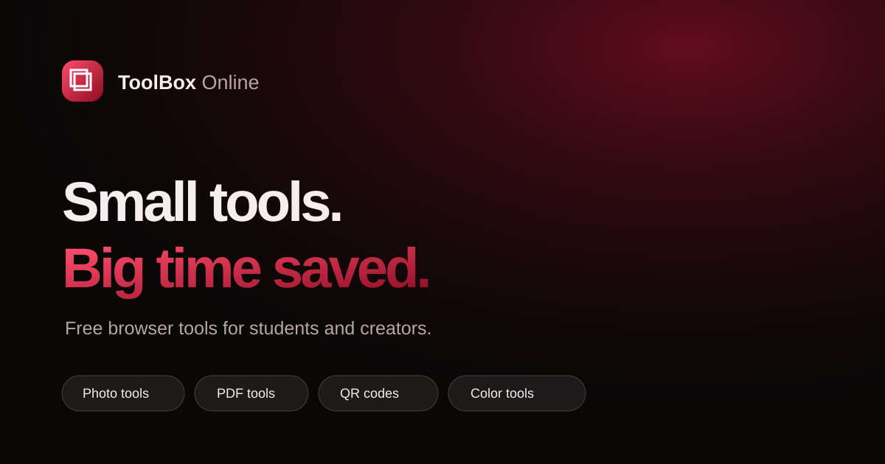

# ToolBox Online

Small, practical browser tools for students and creators. Most processing stays on your device.
The Background Remover sends the selected image to remove.bg through a Cloudflare Pages Function.



Live sites:
- [toolbox.darki.online](https://toolbox.darki.online/)

## The 13 tools

- Photo & Signature Fixer — resize images for forms.
- Image Studio — resize and compress images.
- Image to PDF — place images into an A4 PDF.
- QR Studio — generate downloadable QR codes.
- Favicon Maker — create a PNG favicon from text or emoji.
- Color Lab — inspect HEX, RGB, and HSL values.
- Gradient Lab — create a CSS gradient.
- Merge PDF — join PDF files in the browser.
- Compress PDF — rasterize PDF pages into a smaller, less searchable copy.
- Background Remover — uses the remove.bg API through the Cloudflare Function.
- Digital Signature — draw and save a transparent signature.
- Word Counter — count words and characters locally.
- Unit Converter — convert common measurements locally.

All tools except Background Remover process files in the browser. The Background Remover uploads
the chosen image to this project's Cloudflare Function, which forwards it to remove.bg.

## Quick start

Requirements: Node.js 22 or newer.

```sh
npm ci
npm run dev
```

## Project structure

- `src/App.tsx` — app shell, hash routes, search, and tool list presentation.
- `src/tools/registry.ts` — tool metadata and lazy-loaded tool components.
- `src/tools/` — one component file per tool.
- `src/core/` — shared browser helpers and pure logic.
- `src/data/presets.json` — photo and signature presets.
- `functions/api/remove-background.ts` — Cloudflare Pages Function for remove.bg.
- `public/` — static assets, headers, robots file, and sitemap.

## Scripts

- `npm run dev` — start Vite locally.
- `npm run lint` — run ESLint.
- `npm run format` — format the repository with Prettier.
- `npm run typecheck` — run the strict TypeScript check.
- `npm test` — run Vitest unit tests.
- `npm run build` — typecheck and build the production site.
- `npm audit --omit=dev` — review production dependency advisories.

## Deploy to Cloudflare Pages

Connect the repository to Cloudflare Pages. Set the build command to `npm ci && npm run build` and
the output directory to `dist`. Keep the project root at the repository root so Cloudflare detects
the `functions/` directory. Configure `REMOVEBG_API_KEY` and `TURNSTILE_SECRET_KEY` as encrypted
secrets, `VITE_TURNSTILE_SITE_KEY` as a public build variable, and bind a KV namespace as
`RATE_LIMIT_KV`. Detailed setup is in [CLOUDFLARE_SETUP.md](CLOUDFLARE_SETUP.md).

GitHub Pages cannot run the Background Remover Function.

## Add a new tool in five steps

1. Add a component under `src/tools/` and keep any file processing local unless clearly disclosed.
2. Export it as the file's default React component and give its controls accessible names.
3. Add a lazy import and one metadata entry in `src/tools/registry.ts`.
4. Add or update unit tests for its pure logic in `src/core/`.
5. Run lint, typecheck, tests, build, and manually check desktop and mobile layouts.

## Add a photo preset

Add an entry to `src/data/presets.json` with a name, width, height, unit, minimum and maximum KB,
and output format. Include a source or explanation for country-specific exam requirements in the
pull request.

## Roadmap

- Passport photo print sheet
- Resume builder
- Watermark tool
- Image converter, including HEIC
- Screenshot beautifier
- Mockup generator
